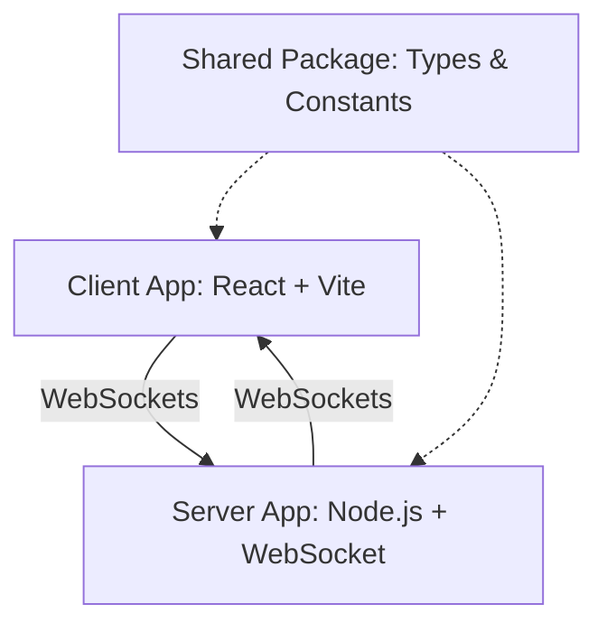

# PlanItPoker

A real-time planning poker application designed for agile teams to estimate tasks. This project is structured as an npm workspaces monorepo containing a React frontend, a Node.js backend, and a shared types package.

## Architecture

The application uses a client-server model communicating over WebSockets for real-time state synchronization.

### Monorepo Structure

- **`apps/client`**: The frontend application. Built with React, Vite, and Ant Design. It uses native WebSocket to connect to the backend.
- **`apps/server`**: The backend server. Built with Node.js, Express, and native WebSocket (`ws`). It manages the state of all active rooms and handles WebSocket connections.
- **`packages/shared`**: A shared library containing TypeScript interfaces, enums, and constants used by both the client and server.
- **`docs/security-review.md`**: the penetration test of the HTTP and WebSocket surface, its findings and the abuse controls that answered them.
- **`docs/regression-playbook.md`**: the release regression gate — automated inventory, chaos experiments and exploratory charters.

### Security Model

- **Session tokens**: On create/join the server issues an opaque token (`apps/server/src/sessionService.ts`) bound to the room participant. Reconnection is only honored when the token proves ownership of the `userId`; a client-supplied `userId` alone is never trusted. Tokens are revoked on kick.
- **Payload validation**: Every inbound WebSocket message is validated against a `zod` schema (`apps/server/src/validation.ts`) before reaching domain logic. Invalid payloads receive an `ERROR` and are never broadcast.
- **Input limits**: Names (≤50), room titles (≤120), story titles (≤120), descriptions (≤2000), bulk imports (≤50), custom decks (2–30 unique cards), and timer durations (5–3600 s) are enforced server-side. Limits are shared constants in `packages/shared`.
- **Safe export**: CSV export neutralizes spreadsheet formula injection and sanitizes the download filename (`apps/client/src/components/story-backlog/story-backlog.utils.ts`).
- **Room codes**: 8 characters from a 32-character alphabet (~1.1×10¹² candidates), so a code is a secret rather than a guessing game. Ambiguous characters (`0`/`O`, `1`/`I`) are excluded so a code can be read out loud.
- **Behind Cloudflare**: the server takes the real client from `CF-Connecting-IP`, and only for requests that genuinely arrive from a published Cloudflare address — a forged header from anywhere else is ignored, so a client cannot choose its own identity by sending one. `X-Forwarded-For` is not walked in front of Cloudflare, because the value a client sent before Cloudflare overwrote it is not a claim worth honouring. Set `CLOUDFLARE_ENABLED=true` on the server.
- **Abuse controls**: every WebSocket connection carries an `error` listener, so a frame the receiver refuses (over the 32 KiB cap) closes that socket instead of the process; one address may hold a bounded number of sockets and a bounded number of failed room joins; message dispatch only honours types the handler owns. The per-address ceilings are sized for a shared address — an office or a carrier-grade NAT is a crowd, not a flood — and a code that matches a room is never refused by the join budget. See `docs/security-review.md`.
- **Frame safety**: a bulk import is split into batches that each fit in one frame, measured as the exact message they become (`apps/client/src/utils/bulk-import.ts`), because a full import is larger than a frame accepts.

### Styling

The client renders entirely with [Ant Design](https://ant.design) 6 components — no CSS files, CSS modules, or CSS-in-JS layers.

- **Global theme**: `apps/client/src/theme/app-theme.ts` is the single `ConfigProvider` configuration. It switches the design-token algorithm per colour scheme and carries the only token overrides in the project, each a documented WCAG AA contrast correction.
- **Per-component tokens**: components consume the active theme through `theme.useToken()` rather than hard-coded colours.
- **Component layout**: one component per folder, kebab-case, under `apps/client/src/components/`. Logic lives in colocated hooks or `.utils.ts` files; only the component itself lives in the `.tsx`.
- **Accessibility**: `apps/e2e/tests/overlap-axe.spec.ts` scans the lobby, the room and the revealed results on four viewports in both colour schemes, asserting zero axe violations and zero overlapping text or interactive elements.

### Internationalization

The interface ships in English, Brazilian Portuguese and Spanish, on top of `i18next` + `react-i18next`.

- **Catalogs**: `apps/client/src/assets/locales/<code>.json` holds one flat key → string map per language, in the format every i18next-aware translator tool reads. `Dictionary` is derived from the English JSON, so a translation missing a key fails `tsc`; the i18n spec rejects one that invents an extra key. English and Brazilian Portuguese are bundled inline; every other language is fetched as its own chunk when picked, and a stored language survives a reload even when its chunk is still loading.
- **Interpolation**: the library's defaults, not a hand-rolled formatter — `t('nav.room', { code })` against `"Room: {{code}}"`, with i18next handling nesting and escaping. Components never interpolate strings themselves.
- **Plurals**: CLDR suffixes — `results.votes_one` / `results.votes_other` — selected by `Intl.PluralRules` from the `count` parameter, so callers write the base key (`t('results.votes', { count })`). A language with more categories (Polish, Russian, Arabic) only adds the extra suffixes.
- **Picker and persistence**: `components/language-switcher/` renders the menu; the choice is stored in `localStorage` (`planit_language`), the browser preference decides the first visit, and Ant Design's own locale (`ConfigProvider`) follows the same value.
- **Server failures**: the server keeps sending an English `message` for its logs, and the client renders the localized text of the accompanying `ErrorCode` through `ERROR_KEYS`; deck names go through `deckLabelKey` so a new `DeckType` or `ErrorCode` cannot be silently untranslated.

#### Adding a language

1. Copy `assets/locales/en.json` to `assets/locales/<code>.json` and translate the values, keeping the keys and the `{{placeholders}}` — the compiler lists every missing key, and add `_few`/`_many` forms only if the language needs them.
2. Add the code to `Language`/`LANGUAGES` in `apps/client/src/i18n/languages.ts` and register the loader in `i18n/dictionary.ts`; add the Ant Design locale in `app/app.tsx`.
3. Add its native name under `language.<code>` in every catalog and run the client tests — the key-set, plural and provider specs fail if something is missing.

Nothing else: `assets/locales/` is excluded from the Sonar scan as a whole, so a new catalog needs no analysis change. Keep the folder JSON-only — the i18n spec fails otherwise.

### Voting Rounds and Summary

- **Rounds**: each reveal appends a snapshot of the active story (`rounds`, capped at `MAX_ROUNDS_PER_STORY = 10`), holding the card, the voter name and the reveal timestamp; resetting the votes opens the next round instead of erasing the previous one. Only revealed rounds are stored, so this introduces no way to read a hidden card.
- **Summary**: `components/session-summary/` derives the end-of-session overview from the broadcast state — estimated stories, accepted points, rounds, duration and a CSV export — and opens once when the host ends the session.
- **Statistics**: `apps/client/src/utils/estimation-stats.ts` computes average, median, population standard deviation, consensus, mode and Tukey outliers from the numeric cards only; symbolic cards still shape the distribution.

### System Diagram



## Requirements and Features

The application supports multiple users connecting to a single room to vote on task estimates. Users can hold different roles within a room, which dictate their permissions.

### User Roles

1.  **Administrator**: The creator of the room. Possesses full control over the room settings and participants.
2.  **Co-host**: Appointed by the Administrator. Possesses the same management permissions as the Administrator, except for transferring the primary Administrator role.
3.  **Voter**: A standard participant who can submit votes on active tasks.
4.  **Spectator**: A participant who can observe the room activity but cannot submit votes.

### Functionalities

- **Standard Features**:
    - Join a room using a unique URL.
    - Select a card to submit an estimate.
    - Toggle personal status between Voter and Spectator.
    - View the current story backlog, with a per-story breakdown of every revealed round.
    - **Voting rounds**: re-voting a story keeps the previous rounds instead of erasing them, so the room can compare attempts before accepting a number.
    - **Result statistics**: average, median, consensus, top vote, voters and population standard deviation, plus the voters whose card falls outside 1.5 interquartile ranges.
    - **Session summary**: ending a session opens a summary with the accepted points, rounds and duration, the round-by-round breakdown of each story, and a CSV export of it.
    - **Interface languages**: English, Brazilian Portuguese and Spanish, switchable from the application bar and remembered across reloads.
    - **Full Responsiveness**: Access and interact seamlessly across mobile devices, tablets, and desktops.

- **Administrative Features** (Restricted to Admin and Co-host):
    - **Room Settings**: Rename the room, lock/unlock the room to prevent new joins, and change the estimation deck type (e.g., Fibonacci, T-Shirt sizes).
    - **Participant Management**: Kick users from the room, promote users to Co-host, and transfer the primary Administrator role.
    - **Voting Control**: Reveal all submitted votes, reset the current voting session, and finalize the agreed-upon estimate (automated average/mode or custom manual override) with automatic progression to the next backlog story.
    - **Backlog Management**: Add new stories, delete stories, bulk import stories, and manually edit story estimates.
    - **Time Management**: Start, stop, and manage a synchronized countdown timer for discussions.

### UI & Responsiveness Principles

- **Mobile-First & Multi-Device Support**: All UI components (Navbar, Poker Table, Participant Seats, Card Deck, Estimation Results, Backlog Drawer, and Settings Modals) must be fully responsive across all viewport sizes (from 320px mobile to 4K displays).
- **Fluid & Adaptive Dimensions**: Elements must scale dynamically without causing horizontal scrolling, text clipping, or element collisions.
- **Touch-Friendly Targets**: Controls and cards provide comfortable touch targets and intuitive micro-interactions for mobile and desktop users.

## Build and Run Steps

### Prerequisites

- Node.js (v20 or higher)
- npm

### Installation

1.  Clone the repository.
2.  Navigate to the project root directory.
3.  Install dependencies for all workspaces:

```bash
npm install
```

4.  Build the shared package (consumed from `dist/` by the apps):

```bash
npm run build:shared
```

### Development

There is no root `npm run dev` script. Start both sides separately from the root directory:

```bash
npm run dev:server   # Express + ws on http://localhost:5000
npm run dev:client   # Vite on http://localhost:5173
```

- The client will be available at `http://localhost:5173`.
- The server will run on `http://localhost:5000` (override with the `PORT` env var).
- In development the client proxies `/ws` to `ws://localhost:5000` via `apps/client/vite.config.ts`.

### Dev Containers

The repository ships a ready-to-use devcontainer defined in `.devcontainer/devcontainer.json` and `.devcontainer/Dockerfile`. Open the folder in VS Code and choose **Reopen in Container** (or use GitHub Codespaces). You get Node 24 LTS, the `github-cli` extension pack (ESLint, Prettier, Playwright, SonarLint, Vitest), forwarded ports `5000`/`5173`, a deterministic `npm ci` install, the shared package build, and Playwright Chromium — with OS dependencies baked into the image so container creation is faster and browser binaries stay locked to the workspace's `@playwright/test` version.

### Testing

The project uses Vitest for unit/integration testing and Playwright + Axe-core for E2E and visual validation.

To run the unit/integration test suites across all workspaces:

```bash
npm run test
```

To run tests in a specific workspace:

```bash
npm --workspace=@planitpoker/server run test
npm --workspace=@planitpoker/client run test
```

#### End-to-End & Exploratory Visual Testing

The project uses Playwright with `@axe-core/playwright` for comprehensive End-to-End (E2E) testing and exploratory UI element collision/text visibility testing across multiple viewports:

- **Breakpoints Tested**: Mobile (`320px`), Tablet (`768px`), and Desktop (`1280px`).
- **Validation**: Ensures no overlapping interactive/text elements and guarantees full text readability and WCAG accessibility standards.

To execute the full E2E test suite:

```bash
npm --workspace=@planitpoker/e2e run test
```

To run the visual overlap exploratory validation specifically:

```bash
npm --workspace=@planitpoker/e2e run test tests/overlap-axe.spec.ts
```

### Code Formatting and Linting

The project uses ESLint for code quality and Prettier for code formatting. The configurations are integrated so that Prettier handles all stylistic rules without conflicting with ESLint.

ESLint is configured once at the repository root (`eslint.config.mjs`) and driven by the root `package.json`; individual workspaces have no lint script.

To lint the whole monorepo:

```bash
npm run lint       # report issues
npm run lint:fix   # auto-fix
```

To format all files in the repository:

```bash
npm run format
```

## Deployment (Production)

Deployment is done via **containers**: `apps/server/Dockerfile` (Node 24) and
`apps/client/Dockerfile` (Vite build + Nginx), orchestrated by `docker-compose.yml`.

Build context is always the repository root.

```bash
cp .env.example .env   # adjust ALLOWED_ORIGINS / ports if needed
docker compose up --build
```

- Client: `http://localhost` (Nginx serves the SPA, proxies `/api/*` and `/ws` to `server`).
- Server: `http://localhost:5000` (health at `GET /api/health`).
- Same-origin by default: leave `VITE_WS_URL` empty and the browser uses
  `window.location.host` **at `/ws`** through the Nginx proxy (no CORS setup needed); the path is mandatory, because `/` serves the SPA.
- External backend: `VITE_WS_URL=wss://api.exemplo.com docker compose up --build`
  bakes the URL into the client bundle so the browser dials it directly.
- Behind TLS: set `CLIENT_ID_COOKIE_SECURE=true` on the server so the
  browser-identity cookie is only ever sent over HTTPS. Leave it empty on plain
  HTTP, where a browser would drop the cookie and the kick bar would lapse.

Individual images:

```bash
docker build -f apps/server/Dockerfile -t planitpoker-server .
docker build -f apps/client/Dockerfile -t planitpoker-client .
docker build -f apps/client/Dockerfile --build-arg VITE_WS_URL=wss://api.exemplo.com -t planitpoker-client .
```
