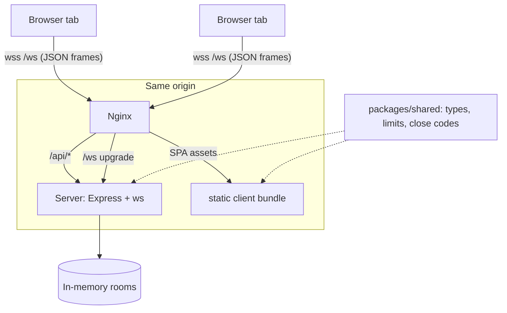

# Architecture Overview

> **Last verified:** 2026-11-26 against commit `4dd98ef`.
> The exact commands to build, test and run live in the repository: [`TOOLS.md`](https://github.com/brunoanhaia/planning-poker/blob/main/TOOLS.md).

## The shape

The same server also runs bare, or split across hosts: the hosted test deployment serves the
client from Vercel and the server from Render, with `VITE_WS_URL` pointing the browser at
the Render WebSocket. The compose stack keeps everything same-origin behind one Nginx.

## The single-writer model

One process owns the truth, and it is not the browser:

- **Every room lives in server memory** as one `RoomState`. All mutations happen in server
  modules; clients only send intents and render what they receive.
- **Every broadcast is per-recipient.** The server sanitizes the state for each socket —
  before a reveal, everyone else's card is nulled while `hasVoted` stays public. A client
  cannot leak a hidden card because it never receives one.
- **State is volatile by design.** A restart empties the rooms, and the hosted free tier
  spins down when idle. This is the honest trade for a dependency-free server; the ceilings
  and the 24-hour idle sweep keep the footprint bounded while it runs.

## Monorepo map

| Workspace         | Role                                                                                                    |
| ----------------- | ------------------------------------------------------------------------------------------------------- |
| `apps/client`     | React 19 + Vite + Ant Design 6. Components are "dumb"; hooks own logic; one `ConfigProvider` theme      |
| `apps/server`     | Express for the hardened HTTP surface, native `ws` for the rooms. No database — memory is the store     |
| `apps/e2e`        | Playwright + axe-core: 4 viewports × 2 colour schemes × 3 states, plus chaos and container gates        |
| `packages/shared` | The contract: types, enums, limits, close codes. Both apps consume it; the docs' numbers come from here |

One build nuance worth knowing: the apps consume `packages/shared` from its compiled `dist/`,
while type-checking reads the source through `paths`. That is why a type change needs a
rebuild before the dev servers — and the unit suites — see it.

## Server module map

| Module                  | Owns                                                                                                                                                           |
| ----------------------- | -------------------------------------------------------------------------------------------------------------------------------------------------------------- |
| `index.ts`              | HTTP hardening (helmet, CORS allowlist, body cap, rate limit), `/api/health`, the identity cookie, the WebSocket upgrade with origin and per-address admission |
| `webSocketHandler.ts`   | Message dispatch, per-action guards, the frozen-after-end read-only rule, broadcasts, the heartbeat and timer tickers                                          |
| `roomManager.ts`        | Rooms, the moderation check (`isUserAdmin`), voting rounds, the idle sweep                                                                                     |
| `participantService.ts` | Roster and roles: join/reconnect, succession, promote/demote, transfer, kick, and the per-recipient sanitization                                               |
| `storyService.ts`       | Backlog: staging, bulk import at the quota, story switching, finalize                                                                                          |
| `sessionRegistry.ts`    | The live socket per participant; closes superseded tabs with 4001 and room switches with 4002                                                                  |
| `sessionService.ts`     | Session token issue and revocation                                                                                                                             |
| `joinAdmission.ts`      | The bars a join passes before the room is even consulted                                                                                                       |
| `banService.ts`         | The 5-minute kick bar on tokens, participant ids and browser profiles                                                                                          |
| `connectionLimiter.ts`  | Per-address socket ceiling on the handshake                                                                                                                    |
| `throttle.ts`           | Per-socket message allowance                                                                                                                                   |
| `auditLogger.ts`        | One structured JSON line per security-relevant action — room and user ids only                                                                                 |
| `validation.ts`         | The zod schema every inbound payload passes before domain logic                                                                                                |
| `clientIdentity.ts`     | The `HttpOnly` browser cookie a kick can name                                                                                                                  |
| `cloudflare.ts`         | The real client address behind Cloudflare, honored only from published ranges                                                                                  |

## Client map

- **`context/socket-context/`** is the only place that talks to the socket: connection,
  reconnection (2 s), token persistence, all intent senders, and notice translation. The
  rest of the app calls intent functions and renders state. A connection banner announces the socket's state (connecting, reconnecting, offline, waking) in a polite live region.
- **Components** are presentation-only, one per folder, with colocated hooks and utils.
- **`i18n/`** owns the catalogs; every user-visible string is a key, and notices are stored
  as codes so they re-translate on a language switch.
- **`theme/app-theme.ts`** is the single `ConfigProvider` configuration; components read
  tokens via `theme.useToken()`.

## Background tickers

Three intervals keep the server honest: a heartbeat (`ping`/`pong`) that terminates dead
connections, a 1-second timer tick for running countdowns, and a cleanup sweep that drops
24-hour-idle rooms (only once everyone has disconnected) together with their tokens, expired
bans and throttle windows.
