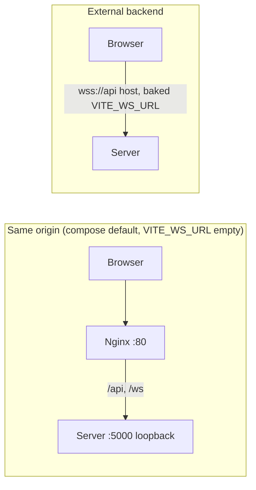

# Deploy with Docker

> **Last verified:** 2026-11-26 against commit `c557e49`.
> The stack is defined by `docker-compose.yml`, `.env.example` and `apps/client/nginx.conf` in
> the repository; this page explains the decisions behind them.

## The stack

```bash
cp .env.example .env   # adjust if needed
docker compose up --build
```

Two services, one origin:

- **client** — Nginx serving the built SPA on the host port you pick (`CLIENT_PORT`, default
  80), proxying `/api/*` and `/ws` (with the upgrade headers) to the server, security headers
  on every route including assets, hashed-asset caching, SPA fallback to `index.html`.
- **server** — Node 24 running the Express + `ws` process, **published on loopback only**
  (`127.0.0.1:SERVER_PORT`, default 5000). Browsers reach it exclusively through Nginx, so
  nothing can bypass the proxy and forge the `X-Forwarded-For` the address-keyed controls
  read. Health at `GET /api/health`, checked every 30 s.

The build context is always the repository root.

## The settings that matter

| Variable                      | What it decides                                                                                                                                                                                                                        |
| ----------------------------- | -------------------------------------------------------------------------------------------------------------------------------------------------------------------------------------------------------------------------------------- |
| `TRUST_PROXY_HOPS`            | `1` behind the bundled Nginx (the default, and what `.env.example` ships). `0` for a direct listener. Getting this wrong collapses every client onto the proxy address — one client can then spend the whole deployment's rate budget. |
| `ALLOWED_ORIGINS`             | Comma-separated origins the handshake and CORS accept. Same-origin needs none; defaults cover direct access and dev.                                                                                                                   |
| `CLIENT_ID_COOKIE_SECURE`     | `true` on TLS deployments so the identity cookie is `Secure`. Leave empty on plain HTTP or the browser drops it.                                                                                                                       |
| `CLOUDFLARE_ENABLED`          | `true` when the stack is published through Cloudflare, so the real client comes from `CF-Connecting-IP`. Leave empty on the bundled Nginx stack — proxy trust there is `TRUST_PROXY_HOPS`.                                             |
| `VITE_WS_URL`                 | Baked into the client at **build** time. Empty (recommended) = same-origin through the Nginx `/ws` proxy; a `wss://…` value makes browsers dial an external backend directly.                                                          |
| `SERVER_PORT` / `CLIENT_PORT` | Host port mappings for the two services.                                                                                                                                                                                               |

## The two shapes



Same-origin is the recommended shape: no CORS, no origin allowlist to maintain, and the
WebSocket path is the `/ws` Nginx owns. The external-backend shape exists for split hosting —
see [[Hosted Test Deployment]].

## Individual images

```bash
docker build -f apps/server/Dockerfile -t planitpoker-server .
docker build -f apps/client/Dockerfile -t planitpoker-client .
docker build -f apps/client/Dockerfile --build-arg VITE_WS_URL=wss://api.example.com -t planitpoker-client .
```

Both images run as non-root users and carry their own `HEALTHCHECK` on `/api/health`.
Remember the operational model of this stack on [[Operations Runbook]]: room state is
in-memory and a restart is a reset.
