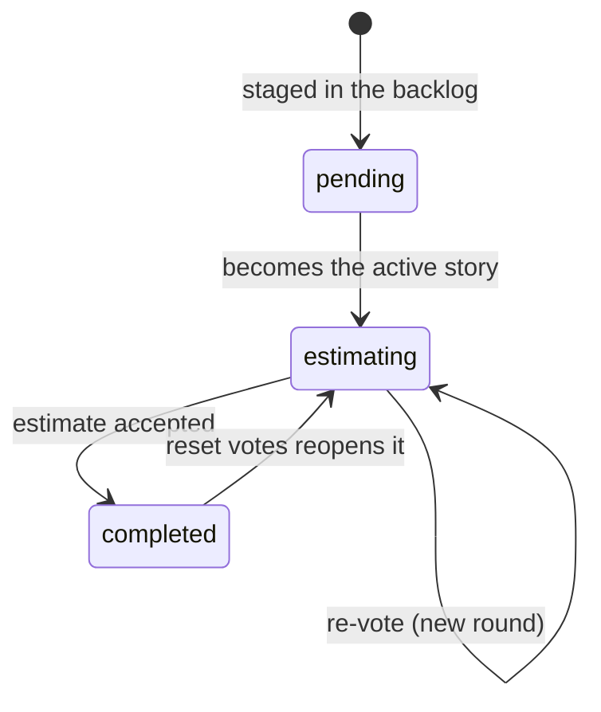

# Voting and Results

> **Last verified:** 2026-11-26 against commit `4dd98ef`.

How a round flows, what the statistics mean, and what the room keeps.

## The life of a story

- **Staging.** The first story to arrive in an empty backlog becomes active at once; later
  ones wait as `pending`. Adding stories never disturbs a round in progress.
- **Voting.** Voters pick a card; only the value is secret until reveal (see
  [[Roles and Permissions]] for who sees what). A revealed round is closed — the server
  refuses further votes on it.
- **Reveal.** Records the round: each card as it stood, the voter's name at that time, and
  the timestamp. Auto-reveal does the same thing without a click, the moment every online
  voter has cast.
- **Re-voting.** Reset opens a **new round** — the previous ones stay, append-only, so the
  room can compare attempts. A story keeps its 10 most recent rounds; the oldest is dropped.
- **Accepting.** An admin accepts the suggested figure or types a manual one; the story is
  marked `completed` and the admin's client moves the room to the next story automatically
  (the last one earns "All stories in the backlog have been estimated!").
- **Reopening.** Reset votes on a finalized story clears the accepted estimate and returns it
  to `estimating` — the recorded rounds survive, because re-voting is meant to be compared,
  not erased.

One honest nuance: the "automatic progression" lives in the **accepting client**, not the
server. The server records the story as completed; whichever admin clicked accept also
switches the room to the next story.

## The timer

- Presets of 30, 60, 120 and 300 seconds, or any duration from 5 s to 1 h (default 60 s).
- Everyone sees the countdown; only admins get the start/pause/reset controls.
- Switching the active story clears the in-flight votes and resets the timer; deleting the last story clears the votes and stops a running timer. Resetting the votes rewinds the countdown to its configured duration, and deleting the **active** story promotes the story that takes its place (or the previous one) and starts a fresh round — only the active story carries the `estimating` badge.

## The statistics

Computed from the **numeric cards only** — `?`, `☕` and T-shirt sizes still count towards
the distribution, the mode and consensus, but never enter the arithmetic. A round with no
numeric card reports `N/A`, not `0`: a team that voted only `?` has an undefined mean, not a
mean of zero. (A custom deck's numeric strings count: `"8"` is `8`.)

| Statistic          | How it is computed                                                                                                                                      |
| ------------------ | ------------------------------------------------------------------------------------------------------------------------------------------------------- |
| Average            | Mean of the numeric cards, shown with 1 decimal                                                                                                         |
| Median             | Middle value; with an even count, the midpoint of the two central cards                                                                                 |
| Mode               | Most frequent card, symbolic or numeric                                                                                                                 |
| Consensus          | Share of the votes carried by the most frequent card, in whole percent                                                                                  |
| Standard deviation | Population (÷ N, not N−1) — the room is the whole population, not a sample                                                                              |
| Outliers           | Tukey's rule: cards beyond 1.5 × interquartile range, by name. Needs at least 4 numeric cards — below that a single high card would brand half the team |
| Full consensus     | Every voter (≥ 2) chose the same card: the room celebrates with confetti                                                                                |

Outlier listing with fewer than four numeric votes is deliberately suppressed — a
three-person team with one outlier is a conversation, not a statistic.

## What the room keeps

- **Round history** per story: every revealed round, its cards and its statistics — visible
  to everyone, including spectators. Unrevealed votes are never stored anywhere.
- **Session summary**: once the host ends the session, everyone gets estimated stories,
  total accepted points, duration, and the round-by-round breakdown of each story, with a
  CSV export. The export is safe against spreadsheet formula injection (`=`, `+`, `-`, `@`,
  tab and CR are neutralized) and the filename is a sanitized slug.
- **The end timestamp is frozen**: ending twice, or a stale tab retrying, cannot move it.
